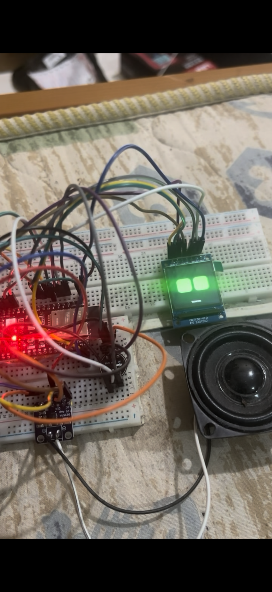
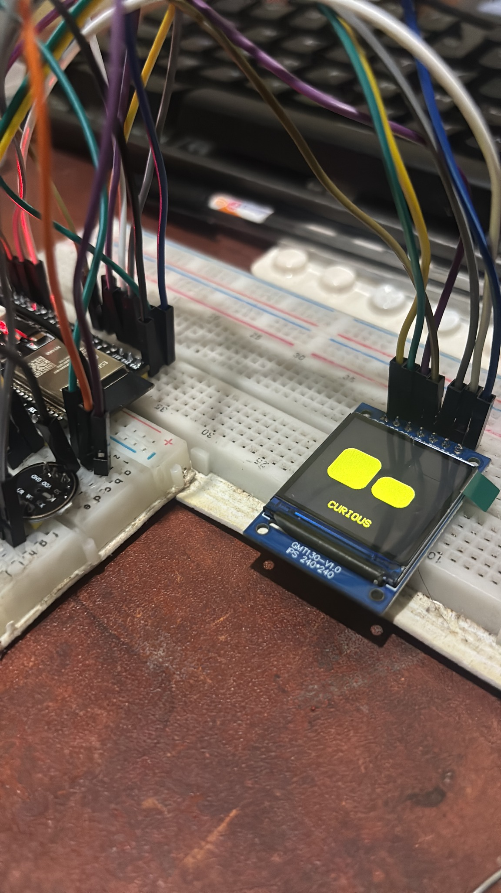

# Mochi AI Chatbot Journey 🤖

**My ESP32-S3 AI companion, from the first display test to a local English voice assistant.**

I built Mochi for **PRINTPRO3D** with an ESP32-S3, INMP441 microphone, MAX98357A I²S amplifier, speaker and a GMT130-V1.0 / ST7789 240×240 IPS display. The project uses a GPIO7 push-to-talk button to send 16 kHz audio over Wi-Fi to a MacBook and play the answer through its own speaker.





## Prototype milestones reported in the project notes

- [x] ST7789 240×240 IPS face, rotated 180°, SPI mode 3
- [x] Green rounded-eye face, blink/status display
- [x] INMP441 mic with 16 kHz PCM capture
- [x] GPIO7 push-to-talk: press/hold, speak, release
- [x] Wi-Fi HTTP upload to MacBook server
- [x] Whisper English speech-to-text
- [x] Ollama Qwen3 **1.7B**, non-thinking mode
- [x] Kokoro `af_sarah` English text-to-speech
- [x] 24 kHz PCM output on MAX98357A speaker
- [x] Automatic state transition READY → LISTENING → UPLOADING → THINKING → SPEAKING → READY
- [x] Reduced voice stutter by disabling TFT redraw during playback
- [ ] Hands-free **Hey Mochi**: experiment only, **not integrated/verified**
- [ ] Conversation memory, home control, web lookup and real music playback

**Honest implementation note:** The code in `firmware/` is a cleaned-up modular reconstruction of the working breadboard sketch, not a binary-identical export of the user's machine. It still needs a fresh physical upload/build test. The Python backend preserves the verified HTTP API. Do not treat checked features above as freshly revalidated on this packaged refactor.

## How it works

```text
INMP441 ── I2S 16kHz ──► ESP32-S3 ── HTTP POST /ask ──► MacBook
   ◄──────────────────────────── ST7789 eyes                 │
                                                              ▼
                                               Whisper → Qwen3 → Kokoro
                                                              │
MAX98357A ◄── ESP32-S3 ◄──── GET /reply.pcm (24kHz PCM) ◄───┘
```

## Quick start

1. [Wire the hardware](docs/WIRING.md) using the previously verified display module pinout.
2. [Set up the MacBook backend](docs/BACKEND_SETUP.md). Install Ollama and download **Kokoro model files locally**; model weights are intentionally not in Git.
3. `cp firmware/include/config.example.h firmware/include/config.h`, then add your private LAN credentials and server IP.
4. In VS Code, open **`firmware/`** as a PlatformIO project, build and upload.
5. Press GPIO7 button, speak for 0.2–5 seconds, release, and hear Mochi reply.

**Troubleshooting:** [Setup and common fixes](docs/TROUBLESHOOTING.md) · [Audio formats](docs/AUDIO_FORMAT.md) · [API](docs/API.md).

## Project history

This archive contains a real `.git` folder with **incremental, meaningful commits** reconstructing milestones from earlier prototype development. They were created at packaging time, not retroactively backdated. Read the [development journey](docs/JOURNEY.md) and use `git log --oneline --reverse` to inspect the sequence. The history does **not** assert that every individual commit existed when the original experiments happened.

## Project status and responsible release

Prototype, English-first. Sinhala Whisper was explored but small-model Sinhala conversation looped, prompting this English implementation. A wake word, live web facts and actual smart-home/music actions are **future work**, not current features. The local HTTP server is for a trusted LAN, not a public deployment. The **original project code** uses the MIT license; every pretrained model and library retains its own terms. See [LICENSING](docs/LICENSING.md), [SECURITY](docs/SECURITY.md) and [ROADMAP](docs/ROADMAP.md).

## Publication checks

Published under [Dileepa Nayanajith](https://github.com/DileepaNayanajith). The supplied archive includes two hardware photographs and no demo video. No generated or stock project images were added. Photo provenance comes from the supplied project notes.

Python syntax checks and all six dependency-free backend unit tests passed during publication on 28 October 2026. Git history was scanned for common credential signatures; configuration contains placeholders rather than personal Wi-Fi credentials. Full firmware compilation, local AI model integration and physical hardware operation were not revalidated here. The 35 supplied milestone commits were preserved; they document a retrospective reconstruction, as described above.
